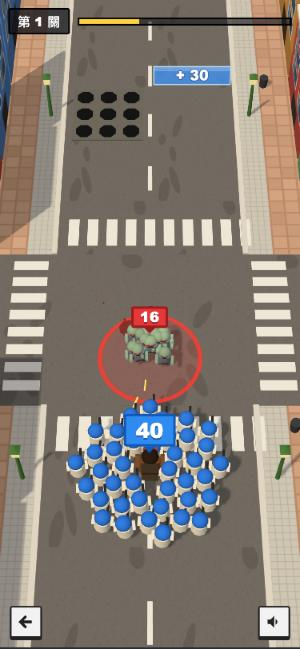
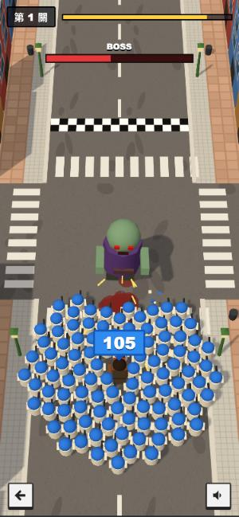

# 末日小隊（暫名）

Last War 廣告裡那個小遊戲的玩法原型：小隊沿街往前衝，左右拖曳選門加人、閃開尖刺和坑洞、自動開槍掃殭屍群，最後打 Boss。人物和介面先照廣告模仿，設定之後再改。

 

## 本機跑

```bash
python3 -m http.server 4490 --directory lastwar-ad
```

打開 http://localhost:4490 ，手機直式最順，電腦可用方向鍵。

## 改設定

- **名稱、數值、關卡**：只改 `js/data.js`。關卡裡每一項是 `{ z: 距離, type: ... }`：
  - `gate` 單一門（`x` 中心、`w` 寬、`op` 是 `+ - x /`、`v` 數字）
  - `gates` 整排左右兩門（`left: ['+', 10], right: ['x', 2]`）
  - `spikes` 尖刺、`holes` 坑洞（`x`、`w` 寬、`d` 深）
  - `horde` 殭屍群（`n` 隻數），`boss`（`hp`、`n` 護衛隻數）
- **人物外型**：`js/main.js` 的 `soldierGeo`（小兵）、`heroGeo`（隊長）、`zombieGeo`（殭屍／Boss）都是程式拼出來的方塊公仔，顏色直接改色碼。
- 測試用：網址加 `?fast=4` 會快轉。

## 玩法細節

- 每個小兵各自判定陷阱，隊伍越大越難完全閃開，邊邊的人會被削掉；有人倒下後停 0.6 秒才補位，壓在陷阱上時不補位、不減速。
- 殭屍群進到 15 公尺內會衝過來，貼上後一換一。開槍距離 16 公尺，射速 = 人數 × `fireRate`。
- Boss 貼身時每秒踩死 `bossHitRate` 個，每死一個給 Boss `bossContactDamage` 傷害，所以人多就硬推得過去。
- 沒有儲值、登入獎勵、等待時間；三關照順序解鎖，存在瀏覽器裡。
